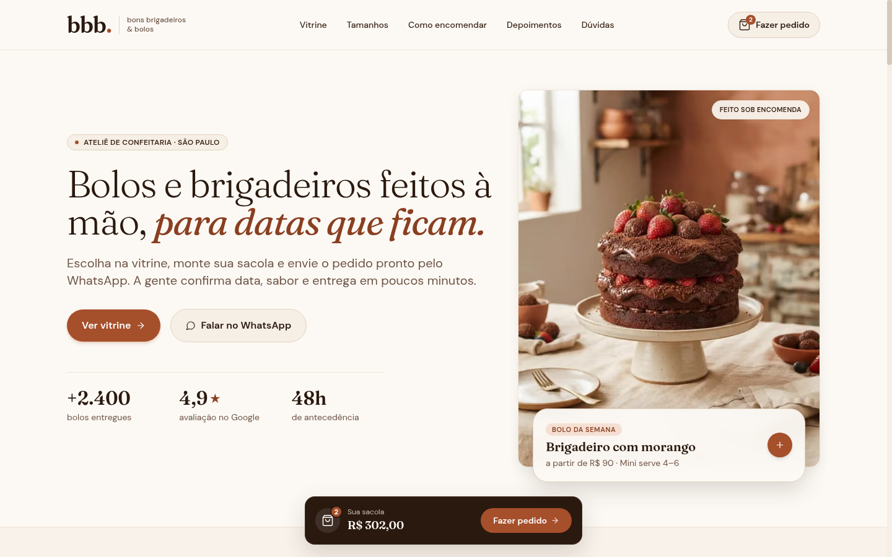
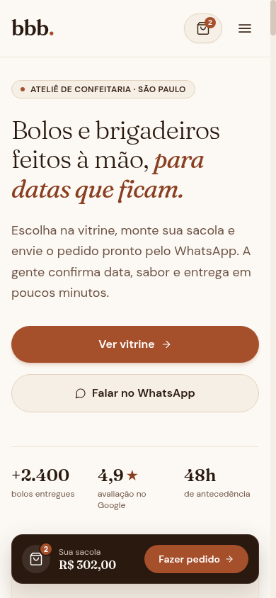

<p align="center">
  <picture><source media="(prefers-color-scheme: dark)" srcset="https://shieldcn.dev/header/graph.svg?title=bbb.&subtitle=Artisanal+Bakery+%C2%B7+Handcrafted+cakes+%26+gourmet+brigadeiros+in+S%C3%A3o+Paulo&align=left&font=geist-mono&mode=dark&logo=https%3A%2F%2Fraw.githubusercontent.com%2FBGLuis%2Fbbb%2Fmain%2Fpublic%2Ffavicon.svg" /></picture>
</p>

<p align="center"><b>English</b> · <a href="README.md">Português (BR)</a></p>

<p align="center">
  <picture><source media="(prefers-color-scheme: dark)" srcset="https://shieldcn.dev/github/stars/BGLuis/bbb.svg?variant=secondary&size=sm&mode=dark" /></picture>
  <picture><source media="(prefers-color-scheme: dark)" srcset="https://shieldcn.dev/github/forks/BGLuis/bbb.svg?variant=secondary&size=sm&mode=dark" /></picture>
  <picture><source media="(prefers-color-scheme: dark)" srcset="https://shieldcn.dev/github/watchers/BGLuis/bbb.svg?variant=secondary&size=sm&mode=dark" /></picture>
  <picture><source media="(prefers-color-scheme: dark)" srcset="https://shieldcn.dev/github/contributors/BGLuis/bbb.svg?theme=emerald&size=sm&mode=dark" /></picture>
  <picture><source media="(prefers-color-scheme: dark)" srcset="https://shieldcn.dev/github/license/BGLuis/bbb.svg?variant=ghost&size=sm&mode=dark" /></picture>
</p>

<p align="center">
  
  
  
  
</p>

# 📖 About

**bbb. (Bons Brigadeiros & Bolos)** is a modern, responsive, and high-performance web application built with Next.js 16, React 19, TypeScript, and Tailwind CSS for an artisanal confectionery studio located in São Paulo (Vila Madalena). The project faithfully implements the original Figma design into a delightful and seamless digital experience for ordering handcrafted cakes, gourmet brigadeiros, fine sweets, and celebration kits, featuring dynamic size selection, an interactive cart drawer with production schedule validation, and instant automated WhatsApp checkout.

# 📋 Motivation

Complete and faithful implementation of the Figma design (bbb · Confeitaria) focused on user experience and 100% Lighthouse performance.

# 🚀 Demo & Links

- 🌐 **Vercel Deployment**: [https://bbb-red-nine.vercel.app](https://bbb-red-nine.vercel.app)
- 📦 **GitHub Repository**: [https://github.com/BGLuis/bbb](https://github.com/BGLuis/bbb)
- 🎨 **Figma Design**:
  - [bbb · Confeitaria (Node 3:3)](https://www.figma.com/design/7NBpHpxgD8zWRdBlg4ZBbY/bbb?node-id=3-3&p=f&t=abdio5EEApZllW0S-0)

# 📸 Visual Showcase

<p align="center">
  
</p>

<p align="center">
  
</p>

# ⚡ Benchmarks & Performance

Official performance audit conducted with **Google Lighthouse** directly against the Vercel production deployment:

<p align="center">
  
  
  
  
</p>

### Core Web Vitals Metrics (Production Deploy)

| Metric | Desktop | Mobile | Google CWV Target | Rating |
| :--- | :--- | :--- | :--- | :--- |
| **Performance** | **100%** | **98%** | ≥ 90% | 🟢 Excellent |
| **First Contentful Paint (FCP)** | 0.4 s | 1.0 s | < 1.8 s | 🟢 Good (Fast) |
| **Speed Index** | 0.6 s | 1.0 s | < 3.4 s | 🟢 Good (Fast) |
| **Total Blocking Time (TBT)** | 0 ms | 20 ms | < 200 ms | 🟢 Perfect (Virtually zero) |
| **Cumulative Layout Shift (CLS)** | 0 | 0 | < 0.1 | 🟢 Perfect (Zero shift) |
| **Largest Contentful Paint (LCP)** | 0.8 s | 2.4 s | < 2.5 s | 🟢 Good (Within target) |

# ✨ Key Features

- **Pixel-Perfect Figma Design Tokens**: Warm aesthetic palette (`cream`, `cocoa`, `terracotta`, `pistachio`), pairing **Fraunces** and **DM Sans** fonts.
- **Hero Section with Weekly Spotlight**: Prominent headline with floating cake-of-the-week badge and direct 1-click cart addition.
- **Dynamic Catalog with Category Filters**:
  - Filter by category: *All*, *Cakes*, *Brigadeiros*, *Fine Sweets*, and *Party Kits*.
  - Interactive size selection (S, M, L or sweet count) with immediate price recalculation and portion estimates.
  - Informative product badges (*"Most Popular"*, *"Limited Edition"*), shelf-life indicators, and direct add-to-bag action.
- **Visual Cake Sizing Guide**:
  - Interactive comparison across Mini (12 cm · 4–6 servings), Small (15 cm · 10–12 servings), Medium (20 cm · 20–25 servings), and Large (25 cm · 35–40 servings) with occasion suggestions.
- **Step-by-Step Order Walkthrough**:
  - 4 clear visual steps: catalog selection, message personalization, 48h advance notice, and pickup or delivery.
- **Heritage & Story Section**:
  - Biographical narrative celebrating grandma Lurdes' family recipes and studio milestones.
- **Verified Customer Testimonials**:
  - Real customer reviews featuring star ratings, photos, and feedback.
- **Interactive FAQ Accordion**:
  - Accessible accordion addressing ordering lead time, storage, delivery radius, and allergen info.
- **3-Step Order Cart & WhatsApp Checkout**:
  - **Step 1 · Bag Review**: Itemized breakdown with quantity modifiers (+ / -), item removal, and real-time subtotal calculation.
  - **Step 2 · Customer Details & Scheduling**:
    - Name and phone input with automatic Brazilian WhatsApp formatting.
    - Calendar validation preventing orders on closed days (Sundays and Mondays) and enforcing minimum 48-hour advance notice for cakes and kits.
    - Delivery vs. studio pickup toggle.
    - Optional custom dedication note on ribbon or card.
  - **Step 3 · Review & WhatsApp Dispatch**:
    - Live formatting preview of the generated message.
    - Direct dispatch link to WhatsApp Web/App with complete pre-filled payload.
- **Media Optimization via `ffmpeg`**:
  - 10 images converted and compressed to `libwebp` achieving >70% file size reduction without perceptible quality loss.
- **Zero Legacy JavaScript**:
  - Modern Browserslist configuration in `package.json` omitting redundant transpilation and polyfills.
- **WCAG AAA Accessibility & Full Technical SEO**:
  - Screen reader accessibility skip link (*"Skip to main content"*).
  - High color contrast compliant across all viewports.
  - Comprehensive Open Graph, Twitter Cards, XML Sitemap, Robots.txt, and JSON-LD structured schema (`Bakery`).

# 💻 Getting Started

### Requirements

- [Node.js](https://nodejs.org)
- [npm](https://www.npmjs.com)

### Installation

1. Clone the repository:

   ```sh
   git clone https://github.com/BGLuis/bbb.git
   ```

2. Enter the project directory:

   ```sh
   cd bbb
   ```

3. Install the dependencies and start:

   ```sh
   npm install
   npm run dev
   ```

Open [http://localhost:3000](http://localhost:3000) in your browser to view the application.

# 🤝 Contributors

<a href="https://github.com/BGLuis/bbb/graphs/contributors">
  <picture><source media="(prefers-color-scheme: dark)" srcset="https://shieldcn.dev/contributors/BGLuis/bbb.svg?title=false&preset=transparent&border=false&mode=dark" /></picture>
</a>

# 📄 License

Distributed under the [MIT](LICENSE) license.
